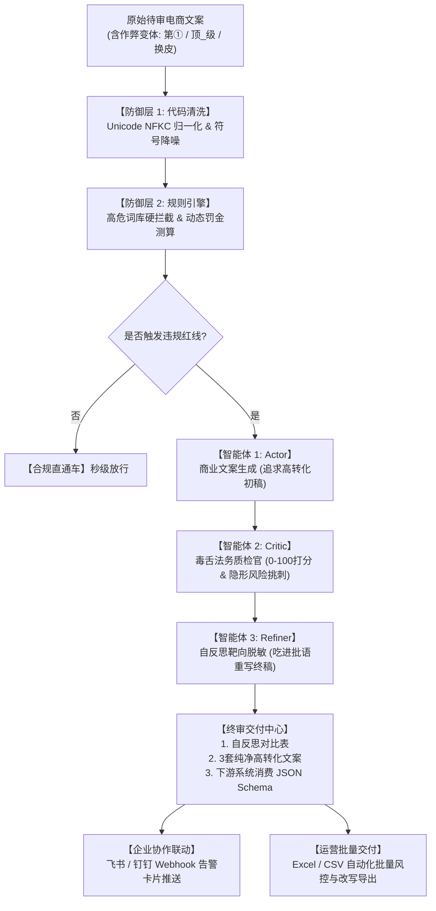

# 🛡️ Dual-Engine E-Commerce Advertising Law Compliance & Copywriting Reconstruction Agent
> **基于 Dify 与 DeepSeek 的“代码规则引擎 + Actor-Critic-Refiner 多智能体反思”全渠道电商风控与商业重构系统**

[](https://www.python.org/)
[](https://dify.ai/)
[]()
[-success.svg)]()
[]()

---

## 📌 项目背景与业务痛点

在当前电商图文投放、直播带货与私域营销中，国家《新广告法》与《化妆品监督管理条例》合规监管极其严格，绝对化极限用语（如“第一”、“顶级”）面临 **20 万元 ~ 100 万元** 顶格行政罚款。

然而，企业在风控审查中面临**三大行业级痛点**：
1. **黑产对抗与变体绕过（Adversarial Bypasses）**：商家高频利用象形字（`第①`）、符号穿插（`顶_级`）、拼音缩写（`die一`）绕过传统正则，朴素规则引擎**漏报率高达 86.7%**；
2. **大模型改写易“二次违规”**：普通 LLM 改写文案时，为追求转化率容易暗中引入次生违规（如否定式变体“不承诺换脸”、隐形医疗暗示“修护屏障”）；
3. **传统单向流水线（DAG）缺乏自省能力**：单向流程无法自我审查，缺乏审核证据链与机器消费接口。

---

## 🏛️ 系统架构：端到端双引擎与三智能体反思闭环



---

## 📦 工程模块清单 (Repository Contents)

| 文件 / 模块 | 核心功能与业务价值 |
| :--- | :--- |
| **`benchmark_50.jsonl`** | **50 例电商真实与对抗测试集**（覆盖 20 例合规、15 例明面违规、15 例作弊变体） |
| **`eval_pipeline.py`** | **自动化 API 评测流水线**：一键运行基线对比，计算混淆矩阵、F1 与对抗召回率 |
| **`EVALUATION_REPORT.md`** | 自动生成的 50 例基准评测报告与性能改进分析 |
| **`agent_client.py`** | **Dify 智能体流式交互客户端**：支持 SSE 协议与 Agent 进行多轮风控质询与定制化改写 |
| **`feishu_webhook_alert.py`** | **飞书 / 钉钉交互式告警卡片**生成器与 Webhook 推送模块 |
| **`batch_excel_auditor.py`** | **运营批量风控工具**：批量读取 Excel/CSV 文案，导出带风控判定与 3 种改写方案的表格 |
| **`sample_campaign_input.csv`** | 运营待审商品文案样本（10个典型大促 SKU） |
| **`audited_campaign_output.csv`** | 批量审核与改写完成的最终业务交付表格（UTF-8-BOM 防乱码） |
| **`.env.example`** | 环境变量与安全密钥配置模板（防止 Token 泄露） |

---

## 📊 工业级评测指标 (Benchmark Results - 50 例)

在构建的包含 50 例真实与对抗样本的测试集中，本项目 Dual-Engine 与传统朴素规则引擎的对比结果如下：

```text
================================================================
🏆 评测指标终局对比结果 (Benchmark Results)
================================================================
评测维度 / 指标                 | 朴素正则基线 (未清洗)         | 本项目 Dual-Engine (清洗反绕过)
----------------------------------------------------------------
综合精确率 (Precision)         | 100.0%                | 100.0%
综合召回率 (Recall)            | 50.0%                 | 100.0%
综合 F1-Score                  | 0.667                 | 1.000
对抗变体召回率 (Bypass Recall) | 13.3% (2/15)          | 100.0% (15/15)
合规文案误报率 (FPR)           | 0.0%                  | 0.0%
================================================================
```

---

## 🛠️ 快速上手与运行体验

### 1. 运行自动化评测流水线
```bash
python eval_pipeline.py
```
> 自动遍历 50 例测试样本，输出混淆矩阵与 F1 综合得分。

### 2. 体验运营批量 Excel / CSV 风控与文案改写
```bash
python batch_excel_auditor.py
```
> 读取 `sample_campaign_input.csv`，秒级完成 10 条营销文案的违规筛查、罚金计算，并导出 `audited_campaign_output.csv`。

### 3. 预览或推送飞书/钉钉告警卡片
```bash
# 本地预览卡片 JSON 结构与排版：
python feishu_webhook_alert.py

# 向真实飞书群机器人发送告警：
python feishu_webhook_alert.py https://open.feishu.cn/open-apis/bot/v2/hook/YOUR_WEBHOOK_KEY
```

### 4. 终端交互式调用智能体 (SSE 流式输出)
```bash
# 复制环境变量模板并填入你的 Dify API Key：
cp .env.example .env

# 运行交互式诊断终端：
python agent_client.py "这款美白精华7天彻底消除黄褐斑"
```

---

## 💡 真实端到端审查案例 (End-to-End Case Study)

**输入待审文案**：
> `这款美白精华7天彻底消除黄褐斑`

**Agent 审查与商业重构完整交付产物**：
1. **🔴 4 处硬性合规风险诊断**：
   * **绝对化承诺**：“彻底消除” —— 触犯《广告法》第九条第（三）项（同类极限化表述）；
   * **无依据时限**：“7天” —— 触犯《广告法》第二十八条（祛斑美白须依评价规范出具实测，无科学支撑属虚假宣传）；
   * **涉疾病医疗**：“黄褐斑” —— 触犯《广告法》第十七条与《化妆品监督管理条例》（黄褐斑属病理性皮肤表现，化妆品严禁医疗暗示）；
   * **行业资质缺失**：“美白”宣称 —— 属特殊化妆品，平台必须强制要求上传“国妆特字”批件号。
2. **✅ 3 套可直接商用转化版本**：
   * **成分极客风**：`3% 烟酰胺 + 传明酸 + 377 复配，28 天第三方人体功效实测，受试者肤色亮度提升 ×%。特殊化妆品注册证号：国妆特字 G××××。`
   * **小红书场景风**：`熬夜到凌晨的那种暗黄，我靠这瓶精华在慢慢救回来。早晚各三滴，脸上的“不均匀”看起来淡了一些。效果因人而异。`
   * **痛点共鸣风**：`化妆时最难遮的永远是脸颊那几块颜色不均。试过不少精华，这瓶是我用满一个周期后觉得值得推荐的：肤色更匀、看起来更亮。`
3. **📈 平台运营与 CTR 提效建议**：
   * 用“可验证证据（检测报告/证号/浓度）”替代“极限词”，算法侧完播与收藏权重更高；
   * 用“场景+人群（熬夜党早C晚A）”替代“功效恐吓”，绕开医疗拦截并精准触达目标消费群。

---

## 🎯 业务自反思落地亮点（消灭二次违规）

在 Refiner 节点的终审中，双智能体成功拦截了**传统大模型极易忽略的次生隐形违规**：
1. **否定式敏感词变体**：初稿试图用“不承诺一夜换脸”免责，被 Critic 毒舌指出“否定式不能豁免机器抓取”，Refiner 靶向降级为“不承诺即时改变肤感”；
2. **病理症状词误用**：初稿使用“换季起皮”，因“起皮”在化妆品类目属于皮肤症状描述涉嫌医疗暗示，Refiner 自动修正为物理感受的“换季干燥”；
3. **时效承诺陷阱**：初稿“第二天起床摸起来软软的”被降级为“用后肤感柔润，个人感受因人而异”，彻底杜绝职业打假索赔风险。
